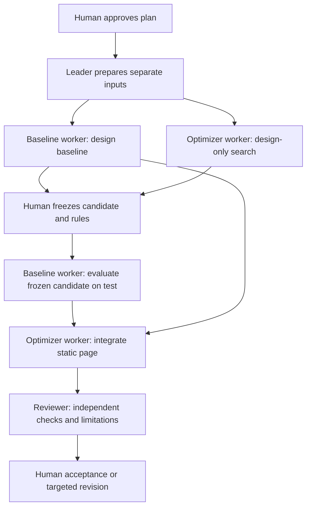

# T3 task brief: a reviewed ETF portfolio experiment

## Research question

Can a simple allocation across SPY, TLT and GLD reduce historical drawdown while preserving the equal-weight portfolio's design-period return? Does the chosen allocation retain that advantage in a later period?

Use this question to practice planning, parallel work, dependent tasks, evidence-based review and human approval in WorkSwarm. A result that fails to improve on the baseline is a valid outcome. Do not claim that historical results identify a strategy that always makes money.

## Fixed experiment

| Item | Rule |
| --- | --- |
| Input | The existing `data/t2/daily_prices.csv`, unchanged. Read `data/t2/data_dictionary.md` for provenance and validation limits. |
| Design window | 2021-09-01 through 2024-08-31, inclusive |
| Test window | 2024-09-01 through 2026-08-31, inclusive |
| Baseline | Exact equal thirds in SPY, TLT and GLD |
| Candidate set | 66 allocations in 10-percentage-point increments, plus the exact equal-weight baseline: 67 candidates in total |
| Constraints | Nonnegative initial weights summing to one. Buy and hold, allowing weights to drift. No rebalancing, leverage or short selling. |
| Selection | Keep candidates whose design total return is at least the baseline's, within `1e-12`. Minimize nonnegative maximum-drawdown loss magnitude, including zero. |
| Ties | For drawdown losses within `1e-12` of the minimum, prefer the baseline if present; otherwise prefer higher return, then ascending `(SPY, TLT, GLD)` weights. Return ties also use `1e-12`. |
| No improvement | Retain the baseline unless the selected candidate's drawdown loss is smaller by more than `1e-12`. |

Each window begins at its own first available common trading close, with portfolio value 100. Each is a separate buy-and-hold experiment. No return from the previous day or previous window is included. The candidate's **initial allocation** is reused in the test window, while the design portfolio's ending holdings are not carried over.

For initial weights `w` and adjusted closes `P`, portfolio value on date `t` is `100 × sum(w[i] × P[i,t] / P[i,first])`. Total return is `last value / 100 − 1`. Drawdown is `value / running peak − 1`; maximum drawdown is its minimum, a nonpositive number. A value closer to zero represents a smaller drawdown loss. Return is the whole-window return, not an annualized return. Compare candidate and baseline within the same window. The design and test windows have different lengths, so their total returns are not directly comparable measures of growth rate. Keep full numeric precision for calculations and round only for display.

Adjusted-close values follow the source provider's split/distribution convention. No separate historical dividend series is reconstructed. Do not deduct current fund fees again. Transaction costs, slippage and taxes are excluded from this simplified experiment.

## Team and approval boundaries

The student chooses an audience and one personal acceptance requirement in addition to the common page requirements below. The student approves the plan before execution and the candidate before test evaluation. Only after plan approval does the Leader prepare the inputs, coordinate actual workers and register dependencies in WorkSwarm. Keep the student's one waiting prediction for comparison with actual task evidence; do not request a duplicate explanation.



- Baseline worker owns `baseline-design.json`, then `evaluation.json` after the freeze.
- Optimizer worker owns `candidate.json`, then the page. It computes its own equal-weight baseline for selection, so it does not depend on the Baseline worker's output file. Before the freeze, this worker reads only `inputs/design.json` for price data. It may inspect the tool and this brief. It must not open `test.json` or the full CSV, or tune rules using test results.
- Reviewer checks the source scope and independently verifies all four return/drawdown pairs: baseline and candidate in each of the design and test windows. It also checks the freeze/evaluation handoff. Repeating the same starter command alone is insufficient evidence. After page review, it writes **Agent check summary** in `t3-notes.md`, stating the method, key results and any unresolved issue. Keep independent review code, detailed results and reproduction commands in the run folder, rather than only in temporary storage. It must not open test prices or calculate test results until the candidate has been frozen. It does not author the candidate, evaluation or page, or invent a failure or student acceptance.
- Reuse the existing workers for later tasks. Register evaluation as dependent on the design work and keep it paused until the student's explicit approval. Integration waits for evaluation; final review waits for integration. Reviewer preparation can run earlier without authoring the final result.
- After the Reviewer finishes the summary, the Leader appends **My three decisions** to the same note using the student's exact words from chat, preserving the review section. Record plan approval, the dependency comparison and candidate freeze, and acceptance or the remaining concern. Each decision needs only 1–2 sentences. Leave an undecided gate pending; never infer approval. Avoid concurrent edits to the shared note.

The split is procedural, with both inputs in the same workspace. T2 already exposed the historical data. Describe this as a **retrospective holdout**, not a blinded or previously unseen market test. The recorded candidate hash proves which file was evaluated; it cannot by itself prove when a person or Agent first saw test data. Any tuning after viewing test results becomes exploratory work and requires a separate label.

The Reviewer also independently enumerates the 67 design candidates and checks the return eligibility, selection, ties and fallback. Correct metrics for one chosen allocation alone do not prove that the selection rule was applied correctly.

## Starter commands

Run from the repository root with Python 3. The tool uses only the standard library and works offline. On systems where the interpreter is named `python`, use that command instead of `python3`.

After the student approves the plan, the Leader prepares the separate inputs. This command validates the source and does not calculate an optimized answer:

```bash
python3 scripts/t3_portfolio.py prepare --csv data/t2/daily_prices.csv --out-dir artifacts/t3/portfolio/inputs
```

After input preparation, the two workers can run these design-only commands in parallel:

```bash
python3 scripts/t3_portfolio.py baseline --design artifacts/t3/portfolio/inputs/design.json --out artifacts/t3/portfolio/baseline-design.json
python3 scripts/t3_portfolio.py optimize --design artifacts/t3/portfolio/inputs/design.json --out artifacts/t3/portfolio/candidate.json
```

Stop here. The `optimize` command prints the candidate's SHA-256, weights and design metrics. The Leader shows the candidate file, weights, rules and design evidence, and records the exact hash. The student explicitly approves the identified candidate in chat and gives a reason; the student need not copy the hash. The Leader binds that approval to the recorded file version and relays it to the freeze task's owner. Preserve the file. The Agent replaces `APPROVED_HASH` below with that exact hash. Evaluation checks the hash before opening the test input. This check catches a changed file; the chat record establishes the human approval. Only then run:

```bash
python3 scripts/t3_portfolio.py evaluate --test artifacts/t3/portfolio/inputs/test.json --candidate artifacts/t3/portfolio/candidate.json --expected-candidate-sha256 APPROVED_HASH --out artifacts/t3/portfolio/evaluation.json
python3 scripts/t3_portfolio.py page --baseline artifacts/t3/portfolio/baseline-design.json --candidate artifacts/t3/portfolio/candidate.json --evaluation artifacts/t3/portfolio/evaluation.json --out docs/t3/portfolio/index.html
```

The tool refuses to overwrite existing outputs. Preserve an existing experiment. If a real error requires a correction, have the Leader explain which files depend on it, record the reason and use a clearly named revision directory. A candidate changed after evaluation must receive a new evaluation and be labeled accordingly.

The generated page is a starter. The page author completes its “Team interpretation” from the actual design and test results and puts the weights, test comparison and conclusion together near the top for a readable screenshot. Keep full charts and method details below. The author may edit the HTML and presentation while preserving source numbers, the frozen candidate and method. Keep the final page self-contained, with no external libraries, API calls or keys.

The separate Reviewer then checks the completed page and writes its summary in `t3-notes.md`; the page does not need to anticipate those findings. If review finds an error, the responsible author makes a targeted correction and the Reviewer rechecks the affected result before updating the summary. The Leader then preserves the student's actual acceptance or revision decision in the note. Open the page in a browser to verify the rendered result. A source-code check alone cannot establish that the page displays correctly.

If a request times out, inspect existing task states, tool activity and outputs before resuming the next incomplete task. Workers may still be running; do not restart the whole experiment or overwrite existing work.

Run the provided synthetic tests with:

```bash
python3 scripts/test_t3_portfolio.py
```

## Outputs and evidence

Keep all new research files under `artifacts/t3/portfolio/` and the page at `docs/t3/portfolio/index.html`. Preserve T1, T2 and any earlier T3 files.

### Two required committed files

- `docs/t3/portfolio/index.html`: weights, design/test metric comparison, test portfolio-value and drawdown curves, interpretation, sources and limitations. Include a condition or limitation that could change the conclusion and meet the student's one personal requirement. The top summary groups weights, the test comparison and conclusion; the rest remains available in the full page.
- `artifacts/t3/portfolio/t3-notes.md`: **Agent check summary** followed by **My three decisions**. The summary must stand on its own: state actual checks, independent method, key findings, the approved candidate version and freeze/evaluation sequence, and unresolved issues. Supporting-file references may add detail. The decisions preserve the student's own plan, handoff/freeze and acceptance judgments. No separate `review.md`, `student-decisions.md` or essay is required.

### Supporting working files retained by the team

- Inputs: `inputs/design.json`, `inputs/test.json`, `inputs/manifest.json`.
- Design results: `baseline-design.json`, `candidate.json`.
- Test results: `evaluation.json`, including the SHA-256 of the frozen candidate bytes.
- Independent review code, detailed results and reproduction commands, including all four return/drawdown pairs and the full design-candidate selection check.

Keep these supporting files in the run folder for reproduction. They may be committed, but are not individually required or graded submissions. The lighter hand-in does not remove any calculation, independent check or human approval gate. Do not delete evidence or earlier work to reduce the submission.

JSON metrics use decimal fractions (`0.05` means `5%`). Each result has a `period` object with requested dates, actual first/last dates and observation count. Curves contain `{date, nav, drawdown}` rows. Input and candidate hashes connect the handoffs. Keep these files inspectable.

Classroom submission is two screenshots (relevant task owners/states with one actual freeze/evaluation dependency; the rendered page summary) and one personal-fork Commit URL containing the two required files. The screenshots need not include every task, log or chart. Follow the student guide for Git commands; do not commit or push on the student's behalf without permission. Scores concern the team's process and evidence, not portfolio performance. Improving the page and publishing it with GitHub Pages is an **optional after-class Bonus**, adding a website URL and updated Commit URL; it is not a classroom completion requirement.
